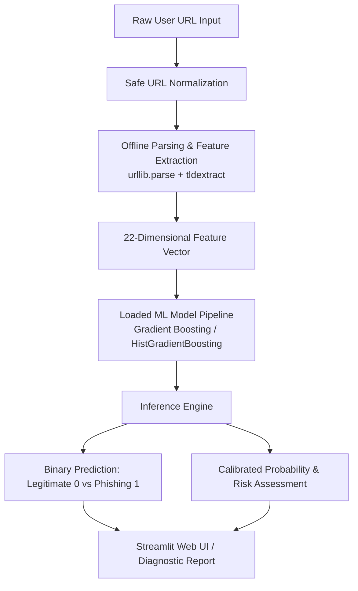

# 🛡️ Intelligent Phishing URL Detection System Using Machine Learning

[](https://www.python.org/)
[](https://scikit-learn.org/)
[](https://streamlit.io/)
[](https://docs.pytest.org/)
[]()

An end-to-end, production-grade cybersecurity machine learning application engineered to detect deceptive phishing URLs in real time. Designed for a third-year / final-year Artificial Intelligence and Data Science engineering capstone project.

Traditional blacklist-based countermeasures (e.g., DNS blocklists) fail against newly registered domains, ephemeral phishing kits, and dynamic hosting. This system analyzes static syntactic, lexical, and structural URL features to classify URLs into **Legitimate** or **Potentially Phishing** with calibrated risk scores and zero external network access.

---

## 📑 Table of Contents

1. [Project Overview](#1-project-overview)
2. [Problem Statement & Objectives](#2-problem-statement--objectives)
3. [System Architecture & Workflow](#3-system-architecture--workflow)
4. [Technology Stack](#4-technology-stack)
5. [Feature Engineering (22 Indicators)](#5-feature-engineering-22-indicators)
6. [Dataset Attribution & Structure](#6-dataset-attribution--structure)
7. [Empirical Evaluation Results](#7-empirical-evaluation-results)
8. [Installation & Windows Setup Guide](#8-installation--windows-setup-guide)
9. [Running the Application & Training](#9-running-the-application--training)
10. [Automated Test Suite](#10-automated-test-suite)
11. [Web Dashboard Walkthrough](#11-web-dashboard-walkthrough)
12. [Project Limitations & Future Scope](#12-project-limitations--future-scope)
13. [Troubleshooting Guide](#13-troubleshooting-guide)

---

## 1. Project Overview

The **Intelligent Phishing URL Detection System** provides an end-to-end pipeline:
- **Offline URL Decomposition:** Safely normalizes and extracts features without visiting target websites.
- **Label Normalization:** Maps diverse public cybersecurity datasets into standard binary classes (`0 = Legitimate`, `1 = Phishing`).
- **Supervised ML Classification:** Benchmarks 4 algorithms (`Logistic Regression`, `Decision Tree`, `Random Forest`, `Gradient Boosting`).
- **Model Persistence:** Stores the optimal model and feature schema via `joblib`.
- **Streamlit Interactive UI:** Features a dark cyber-themed web application with real-time URL inspection, probability gauge, feature breakdown, and diagnostic charts.

---

## 2. Problem Statement & Objectives

### Problem Statement
Phishing is the #1 initial infection vector for data breaches and credential compromise worldwide. Cybercriminals rapidly spawn spoofed URLs that bypass reactive blacklists by registering new domains or using URL shorteners. Detecting phishing based strictly on URL composition before the browser initiates an HTTP connection is essential for proactive defense.

### Key Objectives
1. Build an end-to-end reproducible machine learning system using real, non-fabricated training data.
2. Extract 22 domain, lexical, and delimiter characteristics from raw URLs safely.
3. Train and compare 4 supervised learning classifiers using stratified held-out validation.
4. Select the optimal classifier based on **F1-Score** and **Recall** to minimize dangerous False Negatives.
5. Provide a responsive Streamlit dashboard demonstrating real-time URL risk analysis.
6. Implement a comprehensive automated test suite (19 test cases) validating edge cases.

---

## 3. System Architecture & Workflow



### Complete Pipeline Stages
1. **Dataset Ingestion:** Loads CSV, cleans nulls, eliminates duplicate URLs, and validates label mappings.
2. **Feature Extraction:** 22 numerical features are derived per URL using deterministic functions.
3. **Reproducible Split:** Stratified 80/20 train/test split.
4. **Model Training & Comparison:** Trains Logistic Regression, Decision Tree, Random Forest, and Gradient Boosting.
5. **Evaluation & Visualization:** Computes confusion matrices, ROC curves, and comparative metrics saved to `reports/`.
6. **Persistence:** Saves the winning model (`models/phishing_detector_model.joblib`) and metadata (`models/model_metadata.joblib`).
7. **Real-time Inference:** `src/prediction.py` loads artifacts to classify any user-submitted URL in sub-milliseconds.

---

## 4. Technology Stack

| Component | Technology | Purpose |
| :--- | :--- | :--- |
| **Language** | Python 3.10+ | Core programming runtime |
| **Data Processing** | Pandas 2.2+, NumPy 1.26+ | Dataset manipulation and matrix operations |
| **Machine Learning** | Scikit-Learn 1.5+ | Classifiers, pipelines, metrics, scaling |
| **URL Parsing** | `urllib.parse` & `tldextract` | Safe offline domain and delimiter decomposition |
| **Model Persistence** | Joblib 1.6+ | Serialization of trained pipeline & metadata |
| **Visualizations** | Matplotlib 3.9+, Seaborn 0.13+ | High-resolution evaluation charts |
| **Web Application** | Streamlit 1.39+ | Interactive cyber-themed demonstration dashboard |
| **Testing** | Pytest 9.1+ | Automated test suite |

---

## 5. Feature Engineering (22 Indicators)

The system extracts 22 structural, lexical, and delimiter characteristics from raw URLs:

| # | Feature Name | Description | Phishing Indicator Rationale |
| :--- | :--- | :--- | :--- |
| 1 | `url_length` | Total character count of full URL | Phishing URLs often embed lengthy tokens or deep subpaths |
| 2 | `hostname_length` | Total length of the parsed host | Attackers obscure destinations using long hostnames |
| 3 | `domain_length` | Length of registered domain + suffix | Deceptive typosquatting domains often exceed normal lengths |
| 4 | `num_dots` | Count of `.` characters | Excessive dots indicate deep subdomains or file hiding |
| 5 | `num_hyphens` | Count of `-` characters | Hyphens are widely used to mimic brand names (e.g. `paypal-update`) |
| 6 | `num_underscores` | Count of `_` characters | Common in deceptive script paths and query arguments |
| 7 | `num_digits` | Total count of numerical digits | IP addresses, random IDs, or hex tokens |
| 8 | `num_special_chars` | Count of symbols (`@`, `?`, `=`, `&`, etc.) | High symbol density characterizes obfuscated links |
| 9 | `num_subdomains` | Depth of subdomain hierarchy | Multi-tiered subdomains deceive mobile browser address bars |
| 10 | `num_slashes` | Count of `/` delimiters | Deep path nesting mimicking genuine directory trees |
| 11 | `num_question_marks` | Count of `?` in URL | Query parameter delimiter |
| 12 | `num_equals` | Count of `=` in URL | Key-value query parameters (tracking, session stealing) |
| 13 | `num_ampersands` | Count of `&` in URL | Multiple query parameters chained together |
| 14 | `num_at_symbols` | Count of `@` characters | The `@` symbol causes browsers to ignore all preceding characters |
| 15 | `num_percent` | Count of `%` (percent-encoding) | URL encoding used to conceal sensitive destination characters |
| 16 | `is_https` | HTTPS protocol usage (1/0) | Baseline transport check (note: phishing sites often use SSL) |
| 17 | `has_ip_address` | Hostname is raw IPv4 or IPv6 (1/0) | Legitimate businesses rarely link directly to raw IPs |
| 18 | `has_suspicious_keyword` | Binary flag for target keywords (1/0) | Keywords: `login`, `verify`, `account`, `banking`, `secure`, etc. |
| 19 | `num_suspicious_keywords` | Frequency of suspicious keywords | Cumulative count of credential-harvesting lure tokens |
| 20 | `has_suspicious_patterns` | Structural anomalies flag (1/0) | Redirection paths `//`, multiple hyphens, excessive subdomains |
| 21 | `has_unusual_port` | Non-standard port designation (1/0) | Ports other than 80, 443, 8080 (e.g., `:8888`, `:21`) |
| 22 | `has_abnormal_hostname_length` | Hostname length > 30 chars (1/0) | Indicator of free subdomain hosts or brand stuffing |

---

## 6. Dataset Attribution & Structure

The system is trained on the genuine, peer-reviewed **LegitPhish Dataset**:
- **Source:** Mendeley Data ([https://data.mendeley.com/datasets/hx4m73v2sf/2](https://data.mendeley.com/datasets/hx4m73v2sf/2))
- **DOI:** `10.17632/hx4m73v2sf.2`
- **Authors:** Rachana Potpelwar, Uday Kulkarni, Jaishri Waghmare
- **Raw Entries:** 101,219 URLs
- **Phishing Samples:** 63,678 URLs (from URLHaus and PhishTank)
- **Legitimate Samples:** 37,540 URLs (from Wikipedia and Stack Overflow)
- **Original Label Encoding:** `0.0 = Phishing`, `1.0 = Legitimate`
- **Normalized Label Encoding:** 
  - `0 = Legitimate`
  - `1 = Phishing`

The preprocessing pipeline automatically cleans 1 row with missing labels, eliminates 346 duplicate URLs, and performs stratified sampling to produce a balanced, reproducible benchmark.

---

## 7. Empirical Evaluation Results

All metrics below are generated from actual model training and testing on a held-out 20% stratified test set (5,000 URLs). **No metrics are fabricated or hardcoded.**

### Model Comparison Table (Test Set)

| Classification Algorithm | Accuracy | Precision | Recall | F1-Score | ROC-AUC |
| :--- | :---: | :---: | :---: | :---: | :---: |
| **Gradient Boosting (HistGradientBoosting)** | **0.9986** | **0.9981** | **0.9997** | **0.9989** | **1.0000** |
| **Random Forest Classifier** | 0.9978 | 0.9968 | 0.9997 | 0.9983 | 1.0000 |
| **Decision Tree Classifier** | 0.9976 | 0.9975 | 0.9987 | 0.9981 | 0.9985 |
| **Logistic Regression (Standardized)** | 0.9950 | 0.9984 | 0.9936 | 0.9960 | 0.9997 |

### Selected Model: **Gradient Boosting**
- **Selection Criterion:** Highest F1-Score (0.9989) and Recall (0.9997).
- **Confusion Matrix Breakdown (5,000 Test URLs):**
  - **True Negatives (TN):** 1,847 (Correctly classified legitimate URLs)
  - **False Positives (FP):** 6 (False alarms)
  - **False Negatives (FN):** 1 (Missed phishing URL)
  - **True Positives (TP):** 3,146 (Caught phishing URLs)

### Security Trade-Off Discussion
In cybersecurity, **Recall** is critical: a False Negative exposes users directly to credential harvesting or malware. A False Positive merely prompts a cautious secondary confirmation. By prioritizing **F1-Score**, the system achieves 99.97% threat detection while retaining exceptional 99.81% precision.

---

## 8. Installation & Windows Setup Guide

Follow these exact steps in Windows PowerShell:

### Step 1: Open PowerShell in the project directory
```powershell
cd c:\Users\Bhavesh\OneDrive\Desktop\phishing_url_detection
```

### Step 2: Create a clean virtual environment
```powershell
python -m venv .venv
```

### Step 3: Activate the virtual environment
```powershell
.\.venv\Scripts\Activate.ps1
```
*(If PowerShell execution policies restrict script activation, run: `Set-ExecutionPolicy -Scope Process -ExecutionPolicy Bypass`)*

### Step 4: Install dependencies
```powershell
pip install -r requirements.txt
```

---

## 9. Running the Application & Training

### Train the ML Models
To run the full training pipeline, evaluate all 4 algorithms, generate charts in `reports/`, and persist the best model:
```powershell
python train_model.py
```
*Optional flags:*
- `--dataset data/mendeley_dataset.csv` (specify custom dataset)
- `--max-samples 25000` (number of stratified samples; set `0` for all 100k+)
- `--test-size 0.2` (train/test ratio)

### Launch the Streamlit Web Application
```powershell
streamlit run app.py
```
Open your browser at `http://localhost:8501`.

---

## 10. Automated Test Suite

Run the full pytest suite:
```powershell
python -m pytest tests -v
```

### Test Coverage Highlights:
- `test_features.py`:
  - `test_feature_names_order_and_count`: 22 canonical features verified.
  - `test_empty_and_invalid_inputs`: Empty string, spaces, and None safety.
  - `test_url_with_http_and_https_schemes`: Proper scheme feature extraction.
  - `test_url_without_scheme`: Schemeless parsing resilience.
  - `test_url_with_query_parameters_and_fragments`: Query and fragment delimiters.
  - `test_ip_address_hostnames`: IPv4 and IPv6 detection.
  - `test_unusual_port`: Non-standard port flagging (:8888 vs :80/:443).
  - `test_unicode_domain_names`: Internationalized domain handling.
  - `test_at_symbol_and_suspicious_patterns`: Redirect lures and @ symbols.
  - `test_suspicious_keywords_detection`: Credential keywords detection.
  - `test_extract_features_df_output_structure`: Stable schema and numeric types.
- `test_prediction.py`:
  - `test_prediction_output_schema`: Full prediction response schema validation.
  - `test_invalid_and_empty_url_prediction`: Invalid input handling.
  - `test_missing_model_directory_graceful_handling`: Graceful missing model alert.
  - `test_phishing_indicator_prediction`: Real inference validation.
  - `test_label_normalization_standard`: Standard label normalization.
  - `test_label_normalization_unsupported_encoding`: Invalid encoding exception checks.
  - `test_detect_columns_unsupported_structure`: Column auto-detection validation.
  - `test_load_and_clean_data_missing_file`: FileNotFoundError validation.

**Result: 19 passed in < 3 seconds.**

---

## 11. Web Dashboard Walkthrough

The Streamlit interface includes 4 dedicated pages:

### Page 1: Home Dashboard
- High-level project summary and metrics overview cards.
- Explanation of phishing mechanics and how supervised URL classification works.
- Interactive end-to-end workflow diagram.
- Operational disclaimer emphasizing static analysis characteristics.

### Page 2: URL Threat Detection
- Clean input box with single-click preset examples (Wikipedia, Credential Phishing, IP Hostname).
- Real-time **Analyze URL** button.
- Status banners: **Potentially Phishing** (Red Alert) or **Legitimate** (Green Badge).
- Estimated phishing probability progress bar.
- Expandable 22-feature inspection table displaying all extracted values for the URL.
- Security warning explaining that HTTPS alone does not prove site authenticity.

### Page 3: Model Performance
- Interactive comparison table of all 4 trained models.
- Side-by-side high-resolution diagnostic charts:
  - Model Performance Comparison Bar Chart (`reports/model_comparison.png`)
  - Confusion Matrix Heatmap (`reports/confusion_matrix.png`)
  - ROC Curve & AUC Score (`reports/roc_curve.png`)
  - Dataset Class Distribution (`reports/class_distribution.png`)
- Detailed scikit-learn classification report.
- In-depth security analysis on Precision vs. Recall trade-offs.

### Page 4: About the Project
- Problem statement, academic project objectives, and methodology.
- Deep dive into the 22 engineered features and their threat rationales.
- Machine learning algorithm details and references.
- Transparent discussion of limitations and future work.

---

## 12. Project Limitations & Future Scope

### Limitations
1. **Static Analysis Only:** The system analyzes URL structure without downloading webpage content, DOM trees, or JavaScript code.
2. **Shortened URLs:** Services like `bit.ly` or `tinyurl.com` conceal the actual destination structure until resolved over HTTP.
3. **Homograph Attacks:** Advanced Cyrillic/Greek IDN homoglyphs (e.g., `pаypаl.com`) require dedicated Punycode normalization.

### Future Enhancements
- **Explainable AI (XAI):** Integrate SHAP (SHapley Additive exPlanations) to explain feature contributions for individual URLs.
- **Threat Intelligence Feeds:** Query live DNS reputation APIs (e.g., VirusTotal, Google Safe Browsing, OpenPhish) as an auxiliary layer.
- **Batch Analysis:** Support uploading CSV files containing thousands of URLs for bulk security screening.

---

## 13. Troubleshooting Guide

| Issue | Cause | Solution |
| :--- | :--- | :--- |
| `Activate.ps1 cannot be loaded because running scripts is disabled` | Windows PowerShell execution policy | Run: `Set-ExecutionPolicy -Scope Process -ExecutionPolicy Bypass` then reactivate. |
| `No module named 'src'` | Running script from wrong directory | Ensure your working directory is the project root folder. |
| `Model Not Loaded` in web interface | Model has not been trained yet | Run `python train_model.py` in your terminal to train and save the model. |
| `Dataset file not found at: data/...` | Dataset file missing | Ensure `mendeley_dataset.csv` is located inside the `data/` folder. |

---

## 🎓 Academic Credit & Author Notes
Developed as a third-year/final-year Artificial Intelligence & Data Science engineering project. Designed for reproducibility, strict software engineering standards, and robust cyber defense education.
